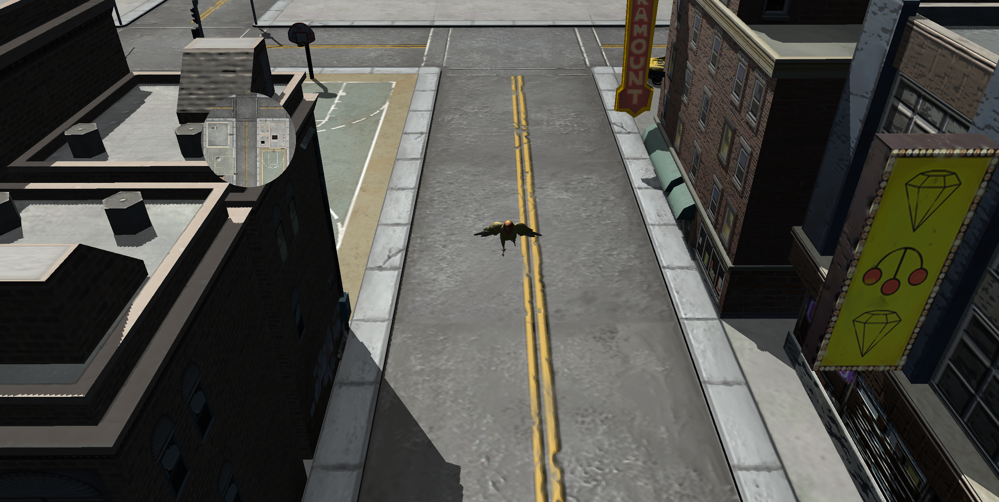

## Project Overview
This is an interactive 3D scene built with C++, OpenGL, and GLSL, using course-provided starter code for mesh importing with Assimp. Play as a lovebird whos escaped in an intimidating, urban city.

## Key Implementations
### Rendering and Lighting
- Phong lighting: Implemented ambient, diffuse, and specular lighting with directional and point lights
- Shadow mapping: Implemented depth-based shadow mapping using directional light and depth comparisons
- Normal mapping by using texture maps to simulate surface details
- Multi-pass rendering: Used separate rendering passes for shadow-map generation, main scene, and minimap overlay

### Camera and Interaction
- Camera controls and orbit rotation: implemented camera movement and rotation around a target point using GLM rotation matrices and vector transformations
- Lovebird movement and flight: directional movement, vertical flight controls, and orientation updates based on movement direction
- hierarchical animation: used parent-child scene objects to animate the lovebird's wings relative to its body
- Circular minimap: rendered from a top-down view of the environment to an offscreen framebuffer, displaying it in a overlay

## How to Run
### Prerequisites
- Windows
- Visual Studio 2022 with "Desktop development with C++" workload

### Build and Run
- Clone this repository
- Open Visual Studio 2022 at the repository's root directory containing CMakeLists.txt
- Wait for Visual Studio to finish loading and configuring the project
- Select Graphics.exe as the startup target
- Press Ctrl + F5 to run the application

## Controls
| Key | Action |
|---|---|
| W / A / S / D | Move camera |
| Q / E | Rotate camera |
| Arrow keys | Move lovebird |
| Space | Fly upward |
| Left Shift | Descend |

## Asset Sources
Third-party 3D models were used for the environment and assets.
- [Lovebird Model](https://sketchfab.com/3d-models/love-birds-parrot-e31e1c72cff140158b99172285b40056)
- [City Environment](https://sketchfab.com/3d-models/ccity-building-set-1-4f4a6740cdfe4e34935eb11d113d771f)
